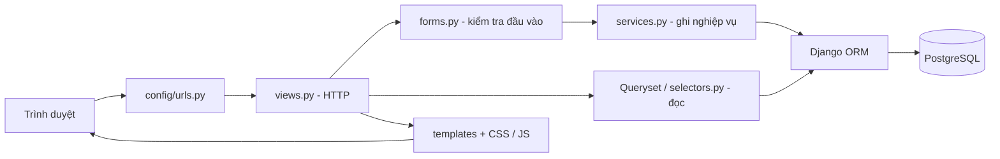
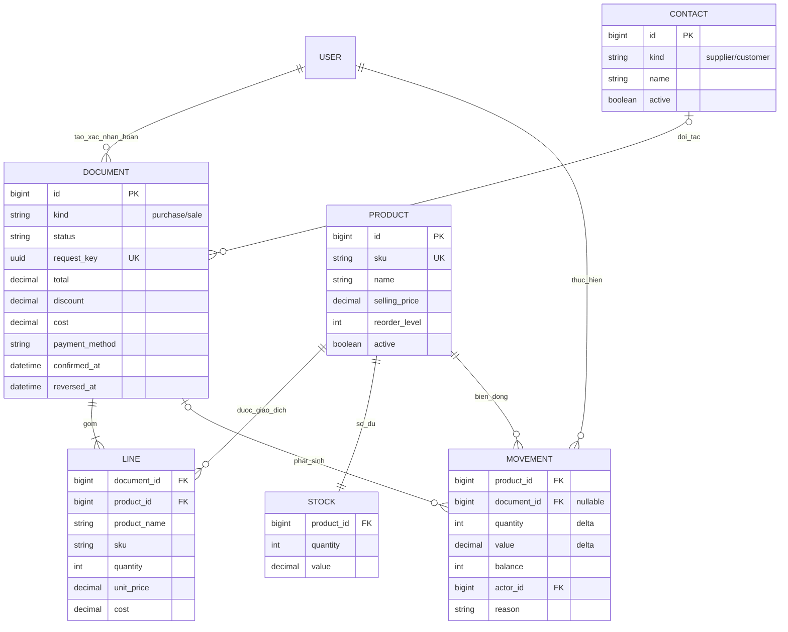
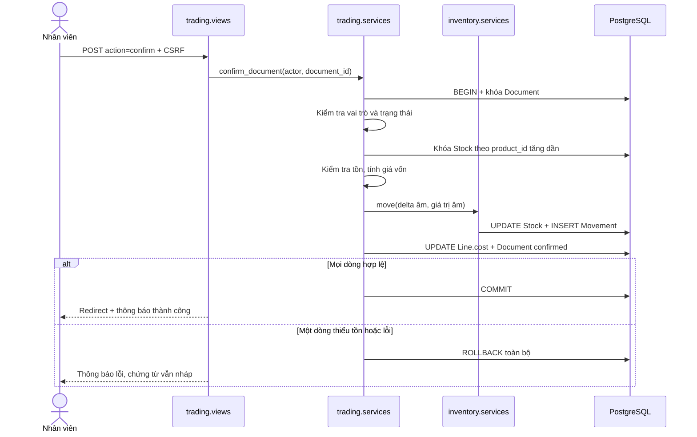
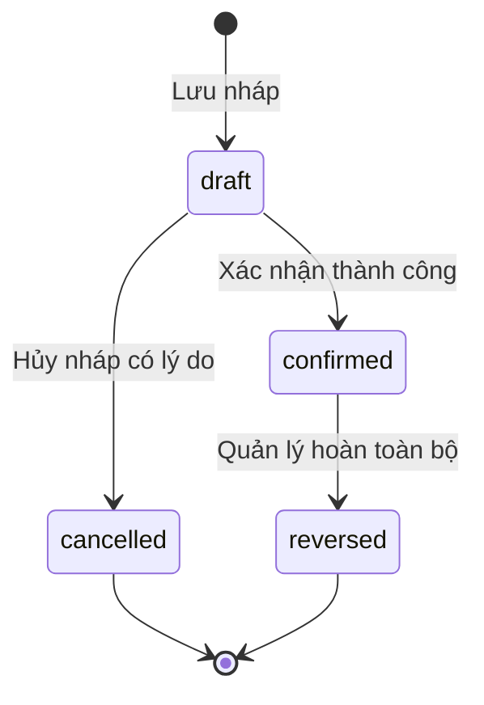
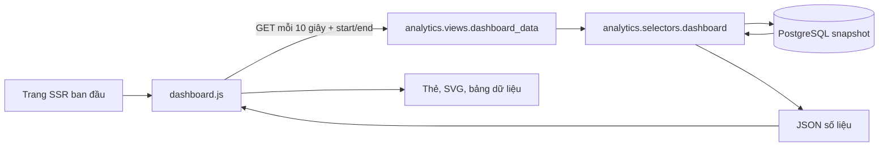

# Kiến trúc StoreDesk

StoreDesk là ứng dụng quản lý một cửa hàng và một kho, dùng **Django modular
monolith**: một ứng dụng triển khai chung, bên trong chia module theo nghiệp vụ.
Giao diện dùng **SSR**: Django tạo HTML từ template rồi gửi về trình duyệt.
Riêng dashboard lấy thêm JSON bằng JavaScript mỗi 10 giây.

Đây là MVT của Django có bổ sung service nghiệp vụ, không phải microservices hay
Clean Architecture độc lập framework. Model/service vẫn sử dụng Django ORM.

## 1. Sơ đồ tổng thể

| Thành phần | Trách nhiệm | Ví dụ trong source |
| --- | --- | --- |
| URL | Ghép đường dẫn với view | `src/config/urls.py` |
| View | Nhận GET/POST, gọi form/service, trả HTML/JSON hoặc redirect | `src/trading/views.py` |
| Form | Kiểm tra kiểu dữ liệu, trường bắt buộc, số lượng, giá trị nhập | `src/trading/forms.py` |
| Service | Quy tắc ghi, kiểm tra quyền, transaction, khóa và cập nhật dữ liệu | `src/trading/services.py` |
| Selector | Truy vấn và tổng hợp phục vụ đọc/báo cáo | `src/analytics/selectors.py` |
| Model | Schema, quan hệ, constraints và thuộc tính dữ liệu | `src/trading/models.py` |
| Template | Hiển thị dữ liệu, form, link và thông báo | `src/templates/trading/detail.html` |
| Static JS | Menu, thêm dòng form, biểu đồ và refresh | `src/static/js/` |
| Scripts | Môi trường Python và vòng đời PostgreSQL/web local | `scripts/`, `run.py` |

Không phải module nào cũng cần mọi loại file. Catalog/inventory có truy vấn danh
sách đơn giản trong view; chỉ tách selector khi có phép tổng hợp đáng kể. Template
không tự viết query. Service không nhận HttpRequest hoặc trả HTML.

## 2. Các module nghiệp vụ

| Module | Sở hữu | Phụ thuộc chính |
| --- | --- | --- |
| `accounts` | Đăng nhập, thiết lập quản lý, tạo nhân viên, vai trò | Django User/Group |
| `catalog` | Product và Contact, giá bán, thông tin đối tác, active flag | Quyền accounts; tạo Stock bằng 0 khi có sản phẩm |
| `inventory` | Stock, Movement, điều chỉnh và đối chiếu sổ kho | Product, User; Movement có thể liên kết Document |
| `trading` | Document/Line, nhập hàng, bán hàng, xác nhận và hoàn | catalog, inventory, quyền accounts |
| `analytics` | Dashboard và kỳ báo cáo | Document/Line, Stock/Product; chỉ đọc |
| `common` | Form style, phân trang, context menu, BusinessError | Django |
| `config` | Settings, routes, WSGI | Ghép các module |

`trading` quyết định giao dịch cần cộng/trừ bao nhiêu; `inventory.services.move`
áp dụng biến động lên số dư và sổ kho. Module analytics đọc kết quả, không thực
hiện giao dịch bán hoặc nhập. Không có một hệ thống tính tiền song song trong JS.

## 3. Sơ đồ dữ liệu

User/Group và quan hệ nhiều-nhiều của chúng do Django Auth quản lý; sơ đồ trên chỉ
hiển thị quan hệ User liên quan trực tiếp đến nghiệp vụ. Diagram là quan hệ nghiệp
vụ: service yêu cầu chứng từ có ít nhất một dòng, không phải constraint số dòng ở DB.

- **Product**: thông tin bán hàng; category là chuỗi, chưa có bảng Category riêng.
- **Contact**: cùng một bảng, phân loại `supplier`/`customer`; đơn khách lẻ có thể
  không có Contact nhưng giữ tên hiển thị snapshot trên Document.
- **Document/Line**: phần đầu và dòng hàng. Một model Document cho hai loại giao
  dịch giúp dùng chung logic nháp, xác nhận và hoàn, nhưng vẫn kiểm tra quyền theo loại.
- **Stock**: số dư hiện tại, mỗi sản phẩm một bản ghi. Phạm vi chỉ có một kho
  nên chưa có bảng Warehouse hoặc chiều warehouse_id.
- **Movement**: thay đổi có dấu và số dư sau thao tác. Điều chỉnh kho không cần Document.

Không có bảng Payment riêng: payment_method nằm trong Document; xác nhận đơn bán
nghĩa là nhân viên đã thu đầy đủ bằng phương thức được chọn. Không tích hợp ngân hàng.

Product/Contact đã dùng được ngừng hoạt động bằng active flag. Các FK quan trọng
sử dụng PROTECT để không mất lịch sử. Line lưu tên/SKU/giá bán khi lưu nháp; giá vốn
chụp khi xác nhận. Chỉnh danh mục sau đó không sửa lại giao dịch cũ.

## 4. Luồng xác nhận bán hàng

Luồng nhập tương tự nhưng cộng số lượng và giá trị theo giá nhập. Hoàn bán cộng
lại chính giá vốn gốc; hoàn nhập chỉ được phép nếu chưa có biến động tiếp theo.

## 5. Vòng đời chứng từ

- Nháp/hủy nháp không làm thay đổi tồn.
- Chứng từ đã xác nhận không sửa dòng hàng. Hoàn là thao tác đảo có lưu actor/lý do/ngày.
- Lặp xác nhận trên confirmed trả lại kết quả hiện có, không cộng/trừ lần hai.
- Hoàn lặp trên reversed không tạo thêm biến động.

## 6. Toàn vẹn và đồng thời

`transaction.atomic` bao toàn bộ thao tác. `select_for_update` khóa chứng từ và các
số dư liên quan cho đến commit/rollback. Khóa sản phẩm theo thứ tự nhất quán để
tránh tình huống các đơn giữ khóa theo thứ tự trái nhau. Hai đơn cùng mua lượng
hàng cuối sẽ kiểm tra tồn lần lượt; đơn đến sau bị từ chối nếu không còn đủ hàng.

Token UUID và advisory lock bảo vệ double-submit khi lưu nháp. UniqueConstraint
ngăn một sản phẩm xuất hiện hai dòng trong cùng chứng từ. CheckConstraint bảo vệ
giá/số lượng hợp lệ; quyền vẫn kiểm tra lại ở service ngay cả khi đã bảo vệ view.

Giá vốn bình quân = tổng giá trị tồn / số lượng tồn. Nếu xuất hết thì lấy toàn bộ
giá trị tồn, không để lại số dư do làm tròn. Nội bộ giữ 4 số thập phân; UI làm tròn VND.

`inventory.checks` và `manage.py check_business_data` đối chiếu sổ kho, giá trị, tổng
tiền và tác động chứng từ. Lệnh chỉ đọc, không “tự sửa” dữ liệu. Báo cáo kiểm tra dùng
snapshot để không lấy các nửa trạng thái khác nhau khi có giao dịch đồng thời.

## 7. Dashboard và “thời gian thực”

- Doanh số thuần = tổng đơn bán xác nhận trong kỳ − hoàn trả ghi nhận trong kỳ.
- Tiền đã thu/hoàn tiền hiển thị riêng; lợi nhuận gộp trừ giá vốn, chưa trừ chi phí vận hành.
- Hoàn hôm nay không sửa doanh số ngày bán cũ; có thể có doanh số âm ngày hoàn.
- Tồn kho là số dư hiện tại, không phải tồn lịch sử cuối kỳ.
- Polling 10 giây, timeout 8 giây, không request chồng; tab ẩn tạm ngưng.
- Khi lỗi mạng giữ dữ liệu cũ và báo chưa cập nhật. Không phải WebSocket/SSE tức thì.
- Bộ lọc tối đa 366 ngày theo giờ Việt Nam; biểu đồ SVG có bảng số liệu để kiểm tra.

## 8. Đọc source và kiểm chứng

Đọc theo thứ tự: `config/urls.py` → `trading/views.py` → `trading/forms.py` →
`trading/services.py` → `inventory/services.py` → các models → `analytics/selectors.py`
→ `static/js/dashboard.js`. Mỗi module chính có docstring mô tả nhiệm vụ ngay đầu file.

| Điều cần chứng minh | Source | Test / lệnh |
| --- | --- | --- |
| Quyền vai trò | `accounts/permissions.py` | `tests/test_web.py`, `tests/test_transactions.py` |
| Snapshot giá | `trading/services.py: save_draft` | `test_price_snapshot_and_draft_idempotency` |
| Không bán quá tồn | `trading/services.py: confirm_document` | `test_concurrent_sales_cannot_oversell` |
| Không xác nhận hai lần | Cùng service + khóa Document | `test_concurrent_confirm_only_once` |
| Không tạo nháp trùng | `save_draft` + request_key | `test_concurrent_draft_request_only_once` |
| Hoàn trả và giá vốn | `reverse_document`, `inventory/services.py` | `tests/test_transactions.py` |
| Doanh số đúng ngày | `analytics/selectors.py` | `tests/test_dashboard.py` |
| Seed không chạy trùng | `catalog/management/commands/seed_demo.py` | `tests/test_seed_and_audit.py` |
| Số dư khớp sổ | `inventory/checks.py` | `manage.py check_business_data` |

Tài liệu liên quan: [Kịch bản trình bày](PRESENTATION.md), [kết quả kiểm chứng](VERIFICATION.md),
[dữ liệu kiểm tra hiện tại](data-check.json), [phạm vi](SCOPE.md).

Tham khảo khóa dòng Django đã đối chiếu:
https://github.com/django/django/blob/6.1/docs/ref/models/querysets.md

## 9. Thao tác dòng hàng trong form

`static/js/document.js` phụ trách thêm/xóa/hoàn tác dòng, không ghi database hoặc
tự tính giá giao dịch. Nút Xóa dòng ẩn ngay dòng đang thao tác, đánh dấu DELETE và
disable input của dòng đó để validation trình duyệt không cản lưu. Formset vẫn giữ
index và TOTAL_FORMS; view bỏ qua dòng DELETE trước khi gọi service. Dòng được
thêm lại dùng slot đã xóa, nên thao tác lặp không làm hết giới hạn formset.

Có Hoàn tác cho lần xóa gần nhất trước khi lưu, giữ nguyên dữ liệu đã nhập. Khi
xóa hết có trạng thái trống và server từ chối lưu chứng từ không có sản phẩm.
DELETE là trường ẩn; nút × được render sẵn trong component document_line.html.
JS xử lý thao tác xóa/hoàn tác. Không có checkbox Bỏ dòng trên UI.
Regression HTTP ở tests/test_document_rows.py bao gồm cả tạo mới/sửa nháp, nhập/bán.
